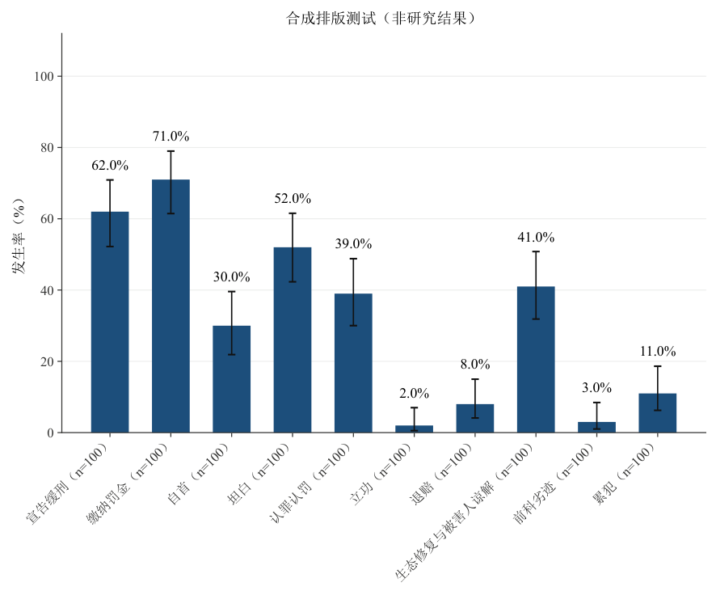

# 2026-11-13：资料真实性、统计方法与论文交付审计

审计对象是本仓库的实际 Python 实现、SKILL、引用文档、配置与安装包，不仅审阅提示词。目标是支持开放的数据集/模型发现、逐格回源复读和可追溯论文产物，并避免工具把“读到部分资料”“数值碰巧相同”或“文件存在”误当作通过。用户追加的图形要求已纳入：**多类别长标签保留同图，优先倾斜，不自动分页。**

本次使用合成资料、独立公式/已知答案、故障注入、真实命令执行与本机 Word/PDF 验证。没有真实研究资料，因此没有生产真实实证结论或论文。原始反例验证分别覆盖资料完整性、统计数值和交付链；修复后以仓库回归测试和重建产物验证。审计发现与最终行为如下，编号是本报告索引，不代表一条恰好对应一个测试。

## 从代码确认的能力

- `audit_corpus`、`text_extract`、`dedupe_corpus`：清点所有文件、识别格式与读取障碍、保守识别重复、产生计划和工作副本操作记录。不是 OCR/ASR/所有格式解析器。
- `make_coding_sheet`、`extract_lib`、`check_decisions`：按 Agent 指定规则提取候选与证据，标记歧义，应用可检查的判断台账；它们不自行理解所有研究语义。
- `verify_dataset`：任意多个注册数据集的主键、每格证据、原文件哈希与位置重开核对、派生复算、整合后第二遍逐格复读的版本绑定。prepare 只产生待核任务，final 需要真实复读记录。
- `run_model`、`source_guard`、`research_gate`：保护和重扫全部原件，执行 Agent 自选的可信分析命令，核对当前数据/规则/复核版本、模型候选、补数回查、样本键及运行回执。
- `auto_stats`、`methods_lib`、`methods_pack`：复用统计内核和编排，不构成模型族或数据集形式的上限。数学模型、其他引擎与自编脚本通过同一证据/回执契约接入。
- `pubfig`、`auto_chart_pack`、`paper_figures`、`assemble_manuscript`、`export_pdf_hires`、`verify_numbers`、`qa_outputs`、`review_pack`：产生图集、表、报告、DOCX/PDF并执行可程序化核查。专业解释、模型识别与语义回读仍由 Agent/实际复核者完成。

## 资料、证据与运行完整性

| 编号 | 发现的风险 | 修复后的行为 / 验证依据 |
|---|---|---|
| A01 | 自编命令可把输出指向 excluded 原件 | 启动前拒绝原始目录、备份目录与原件硬链接上的输出、日志和回执；拒绝时命令未启动 |
| A02 | 未声明原件不受输入校验保护，可能先被破坏后才报错 | 整个 source_root 均备份、临时只读、绑定并在结束时检查；改写/删除尽力恢复且运行失败，新增文件保留并报错；合成故障实测恢复字节 |
| A03 | 删掉旧回执部分版本字段可能复用旧结果 | gate 强制要求当前 final、命令/时间、完整规则/快照/复核/原件绑定、运行器/验证器/保护器代码与无异常保护结果 |
| A04 | observed 空字符串可绕过 missing 规则 | 空值必须为 missing，附理由和来源上下文；键、辅助列和空值同样逐格覆盖 |
| A05 | 默认 Decimal 上下文及 JSON 浮点可吞掉高精度差异 | 派生用精确十进制转有理数复算；JSON 来源精确解析，超长数可显式 number_as_text；10^28+1 与 10^28 不再被当相等 |
| A06 | 审计 corrupt 文件可在覆盖清单中标为 included | included 必须对应 valid；实际读取/转换障碍须修复并重审计 |
| A07 | 内容去重移除标点、大小写，把 1.2/12、a1/A1 合并 | 保留标点/大小写，只做 NFKC 和连续空白折叠；反例分别保留 |
| A08 | 字节组、内容组选 keeper 的口径不同，下游 N 不一致 | 两类重复关系并集合并为统一 dedupe_group/role；unique、计划、编码使用同一角色；冗余数不相加 |
| A09 | 审计后 keeper/副本变化、复用缓存或覆盖移动日志 | 建计划和执行时检查 keeper，执行重算副本 MD5；无哈希不执行；移动历史追加而不覆盖；仍只在工作副本应用 |
| A10 | Office 分离 runs 可能拼错数字，页眉/脚注/备注遗漏 | 按 XML 元素严格解码，段内 run 连续、段落分隔；DOCX 附加故事和 PPT 备注纳入文字；结构表格仍需单元格定位 |
| A11 | PDF 部分页不可读仍按完整资料编码 | 审计为 unreadable 并保留已读字数；extract_text 默认报错，仅显式 allow_partial 用于抢救读取，全坏始终失败 |
| A12 | supersedes 任填、已解决 needs_human 仍阻塞；大数候选用浮点比较 | 必须指向该 target 的确切上一条 id，检查最终有效决定；候选数值用精确十进制比较 |
| A13 | 决策重跑后 review/缺失来源/样本流程/run.json 陈旧 | 用最终值更新证据和 review，排除记录同步移除；重算缺失来源、最终漏斗、当前提取计数和 producer 元数据 |
| A14 | 部分抽取失败仍成功，明确全 NA 又被误称“零匹配” | 抽取异常最终返回 2 并保留诊断；有显式 NA/否定/遮蔽依据的全缺失可保留，不被误当错用 profile |

## 方法、样本量与图中数值

| 编号 | 发现的风险 | 修复后的行为 / 验证依据 |
|---|---|---|
| A15 | 数值剂量因低基数被当类别，整数年龄可能被当分类结果 | 数值预测列默认连续；variable_types、outcome_type 和显式列角色按 codebook 覆盖启发式；冲突/未知列报错 |
| A16 | 分类缺失经 get_dummies 变全零，被误当参照组，甚至效应反号 | 回归先按原始预测列处理完整案例，再建立设计矩阵；独立 OLS 反例恢复正确差值与 N |
| A17 | EFA 相关矩阵用成对案例，Bartlett 却用完整案例 N | 相关矩阵、KMO/Bartlett 采用同一组完整案例并检查退化；用独立相关矩阵/卡方公式比对 |
| A18 | 方差不齐时主结论仍用普通 ANOVA、错误触发事后比较 | 主 F/p 选 Welch，普通结果单列保留；后续按主检验决定，不等方差比较用逐对 Welch 加校正 |
| A19 | ROC/AUC、PR/AP 在并列分数下随行顺序变化 | 同分阈值整体处理；每层一正一负反例在两种顺序下 AUC=.5、AP=.5 |
| A20 | PCA、卡方等实际样本少于报告 N，未知 N 回退全表 | 核心方法写实际 N/配对/时点；缺可靠 N 不用 len(df) 伪造；成对样本不同时不冒充有一个统一标量 N |
| A21 | 自动 PCA 把单位特征向量称作载荷 | 载荷为 V×sqrt(λ)，与变量/主成分得分相关系数独立比对 |
| A22 | EFA 碎石图把保留的解释率重新归一化至 100% | 显式百分比不再归一化，分母是完整变量数；70%+20% 保持 90% |
| A23 | OLS 系数表含全空 OR 列时森林图为空却成功 | 按实际有限系数选择度量，需有效区间；不拿空 OR 覆盖 β，不混画不兼容度量 |
| A24 | p 控制图用平均样本量生成恒定限界 | 中心按各点分母加权，每点使用自身 N，比例限界截至 [0,1]；一般连续控制图可有负下界 |
| A25 | LDA 用未白化欧氏最近中心代替共享协方差判别 | 分类按共享组内协方差逆与经验先验的判别评分；显示坐标与分类规则区分 |
| A26 | 字符串时间按 1,10,11,2 排列，缺期被当等间隔 | 明确解析数值/日期、排序、聚合同一时点，拒绝未明确处理的不规则时间；报告实际时点 N |
| A27 | 纯配对 Wilcoxon 错误要求独立分组，配对图访问不存在 mean | 先处理配对规格，按完整配对原值画个体线与均值/中位数 |
| A28 | KM 缺失过滤掩码长度错误，负随访仍计 N | 使用统一有效掩码，负时间不参与计算或 N |
| A29 | Logistic Wald 列写 z | 写 z²，避免和 Wald χ² 混用 |
| A30 | 显式二元映射 .9/1.9 被 int 截成 0/1 | 只有精确 0/1 可接受；非法映射拒绝 |
| A31 | 相关/Kano 编排静默删掉配置中错误列/配对 | 检查每一项显式请求，不因其他项目有效就把错误项目丢掉 |

## DOCX/PDF、数字核对与密集图形

| 编号 | 发现的风险 | 修复后的行为 / 验证依据 |
|---|---|---|
| A32 | 空数字占位符、中文未知 key 可进入成稿 | key/value 唯一且非空；中文 key 可替换，未知/空值报错 |
| A33 | 重复 CSV 表头覆盖数据、畸形行多余格被丢弃 | 在 DictReader/列选择前检查非空唯一表头、每行列数；不默默覆盖/丢格 |
| A34 | 损坏 PNG/PDF 只留内部错误、QA 总结却通过 | 实际加载图片，所有读取/解析失败升为 error；不是只检查扩展名或路径存在 |
| A35 | 15 cm 图 7.3 pt 缩至 6 cm，2.92 pt 仍通过 | 嵌入图片 SHA 绑定 DOCX 实际宽高，与原始矢量 PDF 折算实际字号；严格模式无法证明时失败 |
| A36 | manifest 成功行无 PNG/PDF 路径仍通过 | 成功行必须有实际产物；skipped/error 明确保留，不能充作成功图 |
| A37 | 只查横向 dpi，纵向 20 dpi 漏检 | 横纵分别计算，取较低值；QA 与 Word 导出检查一致 |
| A38 | 合法窄图约 677 dpi 因低于 3000 px 被拒绝 | 按实际图幅检查有效 dpi；默认关闭固定像素宽门槛，保留舍入容差 |
| A39 | 图注证明自己的正文引用；n、β=.99、p≤、t 等未识别 | 排除声明图注的原样行后找引用；扩充常见写法，仍披露自然语言识别边界 |
| A40 | p/系数沿用 .5 容差，原始数字/模型编号或别的模型也能证明 | 按打印精度和比较符匹配，p/系数禁用通用 raw/narrative 数字池；识别模型/度量上下文；未知 M99 不借 M1，多模型同段提示核查 |
| A41 | 图号对而标题错仍回填，定位失败只是警告 | 同时要求所给标题，缺源图/无法定位/映射重复指向同图均失败并留 unmatched；不能因已有高 dpi 掩盖未完成回填 |
| A42 | 合法零问题 CSV 被 review_pack 称“未提供” | 区分存在的表头零行报告与不存在文件 |
| A43 | .sha256 写内部内容摘要，标准文件哈希不匹配 | sidecar 改为整个 .skill 文件标准 SHA256；内部内容摘要另列 |
| A44 | README 对色觉检查默认值、入口、限制、命令和打包说明不完整 | 重写工作流、脚本索引、实际能力边界与命令；灰度默认开，色觉显式 --colorblind；附本报告与验证路径 |
| A45 | 标题只视觉加粗，Word 导航/大纲无语义 | 正式 Heading 1..9，仍保留指定字体/字号和黑色；非法级别拒绝 |
| A46 | 多个长横轴标签挤在固定画布中 | 同图自适应 45°/60°/75°，增加底部空间；实际旋转矩形检测重叠/裁切，不误把斜文字的外接框交叠当碰撞；无法容纳时报错，不自动分页或缩小字 |
| A47 | 默认标签省略后缀、全 0/1 发生率被省略、非二元值可能截算 | 图包/方法输出保留完整标签；合法常数二元列保留；非 0/1 不计算二元比例，保留具体跳过原因 |

## 验证与可复现产物

**最终完整回归：551 项通过，0 项跳过，耗时 261.203 秒。** 本轮反例回归文件单独执行 45 项通过；多面板/论文图文件单独执行 45 项通过。compileall、skill quick_validate、安装包源码一致性与标准 SHA256 检查通过。长标签合成图 QA 为 0 error / 0 warning，3543×2941 px，600 dpi，源 PDF 最小字号 8 pt；目视检查标签完整且无叠压。验证环境、文件哈希及结果见 [validation.json](audit-2026-11-13/validation.json)，完整测试输出见 [unittest.log](audit-2026-11-13/unittest.log)，图文件检查见 [figure_qa.json](audit-2026-11-13/figure_qa.json)。故障反例会有预期的错误诊断，最终 unittest 汇总为 OK。

测试内容包括已有统计已知答案、提取/决策、审计/去重、CSV/DOCX/PDF 跨脚本契约，以及本轮新增的 `tests/test_audit_regressions.py`。检查不是通过修改预期来接受错误数值：ROC、PCA、Bartlett、p 控制图等使用独立已知答案或公式；错误资料与故障输入必须明确失败。

```powershell
$env:PYTHONUTF8 = '1'
python -m unittest discover -s tests -p 'test_*.py' -v
python -m compileall -q empirical-research-pipeline/scripts tools tests
python C:/Users/20182/.codex/skills/.system/skill-creator/scripts/quick_validate.py empirical-research-pipeline
python docs/audit-2026-11-13/render_dense_chart.py
python tools/build_skill.py
python tools/build_skill.py --check
Get-FileHash -LiteralPath ./dist/empirical-research-pipeline.skill -Algorithm SHA256
```

长标签样例由 [独立合成脚本](audit-2026-11-13/render_dense_chart.py) 生成，10 项均显示在同一张图上，实际采用 45°；每项 100 个合成观察，图中已明示“非研究结果”。[manifest](audit-2026-11-13/dense_chart_manifest.json) 保留整数计数、完整项目、布局修正和产物路径；[矢量 PDF](audit-2026-11-13/figures/fig01_binary_prevalence.pdf) 与 [600 dpi PNG](audit-2026-11-13/figures/fig01_binary_prevalence.png) 可检查。100 个超长类别挤入 15 cm 图宽的反例要求明确失败并保留完整变量清单，不能以漏画、缩字或自动分页掩盖物理限制。



本机实际 Word 验证另覆盖了合成单页稿的三线表/重复表头/行不跨页、中西文字体、页码字段、正常导出与高清回填：3600×1200 原图被 Word 压为 1154×384，回填后恢复 3600×1200；回填前后页数和提取文字一致，末尾中文哨兵保留。另实测了 7.3 pt 源图缩为 6 cm 的字号漏洞；仓库回归保留该已知答案（实际约 2.92 pt）。这些是合成排版/交付验证，不是研究结果正确性的证据。

## 仍需如实披露的边界

1. **不能数学证明“没有幻读”。** 来源精确匹配、哈希、回执和复核声明都不能证明实际理解了主体、时点、单位、否定、建议/已发生或因果设计。必须真的在整合后逐格重开原件阅读上下文；模板不会自动批准自己。
2. **“尽可能全面”需要主动发现。** 无限的数据形态/模型空间无法由有限脚本证明穷尽；registry/model_plan 使已发现候选和未完成项可追踪。内置方法、top-N/矩阵/树图展示策略仍不能冒充完整研究覆盖，须保留全量明细并补齐合理候选。
3. **保护器不是恶意代码沙箱。** 外部命令应可信；本地恢复副本含原始资料，必须沿用资料的访问/保留规则。磁盘故障、备份被破坏或恢复失败会报错，不能保证一切外部环境下可恢复。
4. **解析与来源适配有边界。** 不自带 OCR/ASR、旧 Office 转换、任意数据库或专用数据读取；Office 全文不是布局/单元格坐标保真。转换/OCR 后仍需原件哈希、位置映射、逐值复核，不能把转换文本当新事实。
5. **统计可运行不等于适用。** 未验证全部学科/引擎/模型/参数组合；因果、层级、依赖、缺失机制、抽样权重、多重探索、泄漏与外部效度需按研究设计评估。缺信息就回材料找，不能为跑模型补造数据。
6. **图文 QA 不是语义审稿。** 刻度检测未覆盖任意值标签/图例/跨面板碰撞；数字匹配不能理解所有自然语言指代或变量归属。源 PNG 与矢量 PDF 的同名/哈希关系不能单独证明两者的绘图语义相同；应由受控绘图脚本和运行回执共同产出，并目视核对。
7. **排版验证范围有限。** 实际 Word 覆盖正常单页与物理尺寸反例，未把超长表、多节/横向页、复杂浮动、所有字体缺失、跨机器布局都宣称已验。必须对实际最终稿逐页渲染；当前环境验证也不等于最低 Python/所有依赖版本矩阵验证。

源码、文档、测试与安装包一起维护；修改资料、规则、数据、适配器或代码后，应重新生成快照并实际复核，重跑受影响模型/图文，不能复用旧“已通过”结果。

## 追加反馈 A48：V-05 误把剔除数当实际 N

外部插件使用者反馈后，从生产与消费代码核对并实际复现：5 行完整 OLS 正确输出 `fit.csv: n=5,n_dropna=0`，旧版 `verify_numbers.py` 却优先取 `n_dropna`，报 `V-05 5 vs 0`。`n_dropna` 在生产方明确来自 `n_dropped`，表示因缺失剔除数；错误在本 skill 的消费者及其注释，历史 CHANGELOG 也误记了该优先级。前述 551 项测试未覆盖“真实模型输出→V-05”的这个字段契约，不能作为旧版没有此缺陷的证据。

修复版 `verify_numbers.py 1.0.1` 只取实际拟合 `n`，保留真实差异检查；只有剔除数或实际 n 不可用时 warning“无法核对”，严格终检的 `--fail-on-warn` 阻止假通过。保持 `fit.csv.n_dropna` 列名兼容，并修正 README、SKILL、生产/消费注释、CHANGELOG 和 [插件接入契约](../empirical-research-pipeline/references/10-contracts.md#13-模型样本量与-v-05插件接入语义)。插件源码不在本仓库，此处给出可转交的 tooltip/prompt/状态语义，未声称已修改外部插件。

新增四个回归用例，覆盖剔除数为 0/2/空、真正模型 N 不一致、缺少实际 N 不得回退，以及无缺失/有缺失两种真实 OLS 输出链路。修复后的验证与版本哈希单独记录在 [v05_feedback_validation.json](audit-2026-11-13/v05_feedback_validation.json)，不改写之前验证快照。

本次定向验证：`test_verify_numbers.py` **63 项通过**（40.130 秒），包含新增的 4 个用例及其子场景；原始 5 行反例以修复版重跑返回 0、问题表为空。compileall、skill quick_validate、安装包源码一致性与标准 SHA256 检查通过。本追加修复未重跑前述完整 551 项，不将旧完整回归当成本版全量验证。
