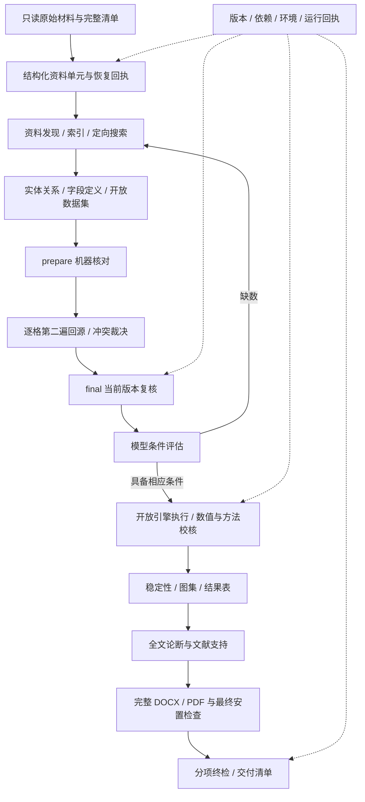

# 实证研究流水线完整强化实施方案

日期：2026-11-14（Asia/Shanghai）

状态：待实施的工程方案；文中的新增模块、接口、字段与命令均为设计，不能当作当前已经可用。

源码基线：`f0c45b4b5eafb86211640e2557ef013f066ef8c3`。本方案形成前工作区无未提交改动。

配套：[36 项实施任务与依赖](research-pipeline-enhancement-2026-11-14.json)、[上一轮源码审计](AUDIT-2026-11-14-PALETTE.md)、[现有开放研究契约](../empirical-research-pipeline/references/12-exhaustive-research.md)。

## 1. 交付目标与范围

全部落实上一轮提出的九个强化方向：复杂资料恢复、主动发现遗漏与补数、逐格复核工作台、跨资料实体整合、开放模型适配、分析稳定性与独立校核、追加资料更新、全文论断与文献核验、最终出版质量检查。优先级只决定施工顺序，九项全部属于完成条件。

完成后的全流程是：接收混合材料 → 登记全部原件与读取范围 → 恢复文字/表格/其他结构 → 发现所有已识别的有用单位和字段 → 形成任意数量与形态的数据集 → 全格逐项回源再核 → 广泛评估数学/统计模型并补取所需真实数据 → 实际运行与独立校核 → 制图、完整研究报告及论文式 DOCX/PDF → 对最终文件再次核查。

“所有已发现项目均有处置”和“所有实际用于结果的数据均经核对”必须可检验。系统不能用一个覆盖率声称已经证明穷尽所有可能语义、数据集和模型；尚不可读、尚未解释、尚未完成的部分必须保留并说明对结论的影响。

### 1.1 继续有效的用户要求

1. 数据集数量、形态、字段、模型族、引擎、脚本、图数和篇幅保持开放；用户补充的形式与材料继续加入。注册表与内置目录提供组织方式，不构成研究上限。
2. 每一项实测值、编码值、主键、空值和派生值有可定位依据；整合完成后，每个正式数据集全部单元格再次逐项回源核对，不能抽查替代。
3. 缺失、未记载、否定、冲突、不适用、遮蔽、不可读、解析失败分别处理。未找到不填 0；估计、插补、图像读数和模拟不能伪装原始精确观测。
4. 每个有合理联系的模型候选逐项评估；数据不足必须回原文件、表格、脚注、附件及其他已提供资料寻找。实现不支持时尝试合适实现，不能直接判成数据不适用。
5. 保留不显著、失败、不适用、数据不足和暂未实现的候选及依据；正式推断只使用得到相应数据与方法支持的结果。
6. 图中项目较多仍优先保留同图，斜放横轴标签、增加留白、调整纸幅/图幅或同图分面；不自动分页、截断、删类别或缩小文字。此要求针对图，DOCX 正文和长表仍可正常分页。
7. 配色、图型示例与推荐样式可调整。灰度和色觉启发式默认建议；明确选用的严格规则按项目执行。
8. 全流程论文任务交付完整论文式 DOCX 与 PDF，以及数据、图集、模型结果、代码和证据；章节结构由实际研究决定。文件生成成功不等于研究完成。
9. 原材料中的指令、宏、命令和脚本作为资料内容处理。执行的工具与分析代码由 Agent 明确选择，保持原件保护和独立输出路径。

### 1.2 本方案的交付界限

本次产出工程方案和任务清单，不将尚未实现的能力写进已发布 skill 的运行说明。后续实施按可验收批次进行；每批必须真正打通生产与消费链路，不能仅增加提示词、空接口、状态字段或展示页面就宣告完成。OCR/ASR、其他计算引擎和文献服务的提供方保持可替换，但对应能力完成时必须有真实提供方的接入证据。

## 2. 当前代码基础与需补齐之处

| 当前模块 | 已具备的基础 | 本次增强落点 |
|---|---|---|
| `audit_corpus.py` / `text_extract.py` | 文件审计、常见格式文字抽取、不可读/图片型识别 | 从文件级推进到页/区域/表格/时间段级结构，增加恢复引擎及位置映射 |
| `make_coding_sheet.py` / `extract_lib.py` | 候选抽取、证据片段、规则与歧义处理 | 接入通用发现与回查，不以既有领域 profile 限制字段 |
| `verify_dataset.py` | 逐格证据、原件回读、精确派生复算、prepare/final 与版本绑定 | 扩展视觉/转写证据、独立复核与冲突记录，维持全格要求 |
| `check_decisions.py` | 判断证据、冲突与 supersedes 链 | 承接实体链接、单位/口径裁决、复核改判和论断处理 |
| `research_gate.py` | 文件覆盖、模型候选、补数记录、样本键与回执校验 | 加入结构级覆盖、实际搜索回执、方法校核和论断/产物状态 |
| `run_model.py` / `source_guard.py` | 开放命令执行、输入/代码/输出哈希、原件保护 | 完整引擎环境、数学模型接口、独立验证和依赖更新 |
| `auto_stats.py` / `methods_lib.py` / `methods_pack.py` | 多类统计方法、部分稳健标准误/多重比较/诊断 | 复用现有实现，补跨模型适配、合理规格稳定性和独立校核 |
| `pubfig.py` / `paper_figures.py` / `auto_chart_pack.py` | 实际颜色、密集标签、图包与部分版式检查 | 将绘图数据、图元、最终安置位置及研究口径联查 |
| `verify_numbers.py` / `qa_outputs.py` | 数字与 N、文件、dpi、字号等检查 | 扩展到全文论断、文献支持、完整图表语义与最终页面 |
| `assemble_manuscript.py` / `export_pdf_hires.py` | 文稿组装、Word/PDF、图题定位和高清回填 | 接入论断/引用/结果标识，核查完整研究叙事与最终版本 |
| `review_pack.py` / `tools/build_skill.py` | 审稿汇总、安装包与标准 SHA256 | 分项完整性报告、迁移说明、集成验证及隔离安装验证 |

上一轮记录的 585 项通过是历史回归基线，不是本方案新增能力的验证结果。C01–C18 的配色、分组、N、极端点、标题/图例、字体和未核语义必须保持；V-05 继续使用实际估计样本数 `n`，`n_dropna` 继续仅表示因缺失剔除数。

## 3. 总体架构与实施方式

资料回查是工作流循环；单个版本的派生依赖仍须无环。补数、改判或重整合生成新版本，不能改写旧回执来消除循环或版本冲突。

实施采用“现有脚本 + 少量共享模块 + 可替换适配器”。拟新增职责可以合并成模块，不要求每个职责建立独立 CLI。Agent 自编脚本或采用其他语言时，只要提供同等输入、输出、证据与校核契约即可接入；不强制经过某一条固定计算脚本。

实际研究只启用当前材料和目标所需的模块；没有音视频不要求安装 ASR，没有优化问题不强行跑求解器。整个 skill 的能力验收仍需验证对应模块真正可用，不能把“本项目不适用”当作产品能力已经实现。

## 4. 九项能力的详细设计

### R01：复杂资料恢复与结构还原

**输入与输出。** 输入是原件及审计记录；输出是 `source_units.jsonl`、恢复产物、恢复回执和未恢复范围。资料单元可为 PDF 页/区域、表格/单元格、Word 正文/表格/注释、Excel 工作表/单元格、图片区域、音视频时间段，或自定义原生结构。

**实施内容。**

1. 设计资料适配器，声明能解析的格式/语言、定位方式、预览方式、版本、参数和失败分类。既有文字抽取为默认适配器，保持旧文本定位行为；新结构接口另行版本化。
2. 处理混合 PDF：有文字层不代表整页已读；检查扫描区域、嵌图中的表格、旋转页和局部文字缺失。区域 OCR 与原文字层去重时保存两种来源及采用依据。
3. 接入可替换 OCR 与版面识别；原始图片、页码、bbox、坐标单位、旋转/缩放变换、引擎输出、转写文本和参数均绑定哈希。坐标能还原至原件。
4. 表格恢复保留原表头、层级表头、行标签、单位、脚注、合并关系、重复跨页表头、续表关系及原始空格。去掉重复表头不删除真正重复观测；表格单元与行列位置一一对应。
5. Excel 保留原值、显示格式、公式、日期纪元、工作表和地址。公式按独立计算处理，不采用可能过期的缓存作为已核事实；合并格只传播表头语义，不把空数据格复制成观测。
6. 音视频接入 ASR/转写适配器，保存时间戳、说话段、可用的说话者标签与不确定位置。无法确认的身份不自动认定；必要时保留人工转写入口。其他专有/多维格式通过原生文件与无损审计视图接入。
7. 识别失败时按实际问题选择更换参数、局部重试、其他引擎或人工读取；记录实际尝试。引擎未安装、语言不支持、不可解密与材料本身模糊分别报告，不能转成空值后标为读完。
8. 图中曲线/柱高的读数若有研究价值，单独登记为数字化近似值，保存尺度校准、读取方法和误差范围；不得补成“原始精确数据”。

**机器与语义边界。** 对视觉证据，机器可核原件/裁片/坐标/转写版本及其一致性，不能从“转写文本等于抽取值”推定原图写的就是该值。正式复核必须回到原始视觉证据；ASR 同理回听原时间段。OCR confidence 只作诊断，不直接授权 verified。

**完成验收。** 至少有真实可运行的 OCR、表格与转写提供方完成对应集成测试；供应商选择由小规模已知答案材料比较决定，不写死在通用 skill 中。跨页、旋转、模糊字符、脚注分母、合并格、公式缓存、局部扫描、损坏/缺引擎均有反例。尚未实际接通的模态标为未完成，不以接口存在充当能力完成。

**对应任务：T04–T07。**

### R02：主动发现遗漏与定向补数

**输入与输出。** 读取资料单元、用户研究目标、用户补充的数据集形式和当前模型需求；输出 `discovery_candidates.jsonl`、资料/结构覆盖、`search_runs.jsonl`、`data_gaps.jsonl` 及更新的数据集注册表。

**实施内容。**

1. 做两条互相补充的发现路径：按资料逐文件/页/表寻找实体、事件、测量、时间、关系与单位；按研究问题与模型需求反向寻找变量、对照、配对、事件和时点。
2. 字段与数据集候选记录来源单元、含义、可取值范围、观测单位、可关联键、研究用途、冲突/歧义与建议数据形态。用户补充的形态单独标记来源，继续发现其他有用形态。
3. 建立可追溯索引：全文、结构、表头、脚注和已定义同义词优先；语义检索为可替换的补充。检索命中只提供候选，取值仍来自实际打开的原始位置。
4. 搜索记录保存目标字段/条件、查询或程序、实际访问的来源单元、索引/源版本、命中、上下文及结果。相同真实搜索可被多个缺口引用；不能生成没有实际执行的逐文件“已搜索”记录。
5. 对“不足”形成完整回路：缺口 → 搜索/恢复 → 找到真实值 → 确认实体/时间/单位 → 补入或建立新数据集 → 重整合 → 全格复核 → 重评模型。找到但不能采用时写实际原因。
6. 对未采用候选保留原因；打不开的区域、未解释的表头、尚未检查的附件及待补字段独立列出。关键词没有命中不能自动证明材料不存在该信息。
7. 做收尾复查：每份材料有处置，每个已识别结构有使用/不使用/未恢复说明，每个已登记缺口有真实回查及终态，每个数据集有模型或描述性评估。注册之外仍允许新增候选。

**停止与完整性。** 停止条件是当前材料的可恢复范围已实际检查、已知候选已处理，或遇到实际访问/引擎条件限制。用户明确预算耗尽时保存待办和部分完成状态；不能用预算结束把未搜索项目改为 not_applicable。没有“自动证明所有可能模型已穷尽”的状态。

**完成验收。** 用预埋字段的合成材料检验同义词、脚注、附件、表格与新单位可被发现；缺口找到后必须真的出现在新数据集及复核记录中。重建过期索引；无法恢复部分不计作读取成功。

**对应任务：T08–T10。**

### R03：逐格证据复核与冲突裁决工作台

**形态与输出。** 提供可离线打开的证据审阅页面或等效本地工作台；CLI 同样可用。页面展示最终值、原始证据、上下文、页码/位置、变换、第一遍抽取和第二遍复核。复核输出是可验证的记录和改判事件，不只是一张页面。

**实施内容。**

1. 以数据集/复合键/列/版本定位全部单元格；键、空值、来源列、标记与派生值包含在分母内。分页/虚拟滚动只影响审阅界面，不能减少复核范围。
2. 文字显示完整上下文；表格联显行列标题、单位和脚注；图片显示原页和裁片；转写显示原时间段。显示可折叠，底层证据不得截断。
3. 支持先隐藏第一遍值的独立再抽取，再比较两遍结果；也支持同一 Agent 的重新回源复读、独立 Agent 或人工。记录真实复核者、方法和独立程度，不强制额外付费审稿者，也不虚构独立性。
4. 不一致时保留两次候选、原件依据、采用理由、规则版本、改判链和受影响范围；未解决保持 disputed，不能自动多数投票决定事实。
5. 不提供未经实际复读的一键全 verified。批量序列化已真实完成的逐格记录可以支持，但输入记录需逐项绑定本次值与证据；时间、勾选或页面浏览日志本身不证明理解正确。
6. 派生值展示全部输入与独立复算；缺失格展示真实回查范围和缺失类型。疑难项可优先呈现，低风险格仍全部核对。
7. 页面编辑生成补丁/事件，经校验后写入新版本，不直接改原件；失效的页面、旧快照或导入的旧复核必须被识别。资料文本按文本显示，不作为脚本执行。

**完成验收。** 原件中出现同一个数字多次、不同实体同名、否定/转述、时间不符、分母脚注、原文冲突和缺失类型都可被定位并裁决。数据/规则变化后旧复核失效；修复并重整合后整表重新 prepare 和第二遍核对。

**对应任务：T11–T13。**

### R04：跨资料实体、关系与口径整合

**实施内容。**

1. 建立带版本的实体、别名、候选匹配与关系记录；实体类型开放，支持人物、机构、文件、事件、测量对象等。结构 ID 与原始编号分开。
2. 使用原始稳定编号、时间、地点和其他实际属性形成匹配证据；相似名称、同一占位姓名和脱敏标识只产生候选，不自动合并。
3. 记录一对一、一对多、多对多、配对、事件顺序、有效时间和跨数据集键；执行连接前校验基数，连接后核对行数、重复与分母变化。
4. 单位换算、时间时区、价格/量表/口径版本按 codebook 明确；量纲不符或分母不一致不直接相加、比较或合并。
5. 不同来源记载冲突时保留全部原值与位置，根据真实研究问题确定采用依据；不能一概取最新、最大值或多数值。未解决关系保持未知。
6. 合并/拆分实体、关系改判或单位规则变更触发版本更新和依赖失效；关联结果本身也进入全格复核。

**完成验收。** 同名异人、异名同体、脱敏名重复、一对多扩行、多对多笛卡尔积、跨期单位改变和修订件均有已知答案。无依据关联和行数膨胀必须可发现。

**对应任务：T14–T15。**

### R05：开放数学/统计模型适配与条件评估

**统一契约，开放实现。** 模型 family 保持自由描述；适配器可由 Agent 选择 Python/R/Julia/SPSS/Stata、求解器或项目实现。登记能力与诊断义务，不规定只准哪些模型，也不要求统一系数表承载所有结果。

**实施内容。**

1. 每个候选记录问题、数据集/输入视图、变量与测量层级、单位、样本/事件/配对/时点/组数、设计/识别条件、参数和验证方法。禁止用一个固定 N 门槛替所有模型作判断。
2. 支持多个数据集共同供给模型；可先建立经过审核的分析视图，或提供明确的多输入映射。样本键和输入引用保持可逐项追踪。
3. 明确分开输入行数、独立个体数、有效配对数、事件数、组数、时点数、权重及其有效样本指标。缺失处理、筛选、重复使用和排除均有实际清单。
4. 保持现有 `run_model.py` 命令数组、原件保护、完整代码/配置/输入/输出哈希和旧输出检查；扩展环境与结果形态，不限制 Agent 自编处理脚本。
5. 统计适配器按实际任务覆盖计数/比例/有序/多分类、生存、层级/重复测量、时序/面板、空间、潜变量、非线性或其他合理方向。该列表是扩展提示，不是终止目录。
6. 数学模型按任务提供约束优化、动态系统、网络/图、矩阵、逆问题、仿真等路径。目标函数、约束、参数来源、初始/边界条件和解的含义分别记录，不以“能求出一个解”证明模型有现实依据。
7. 条件不满足则回 R02 补数；实现故障则做真实安装/替代引擎/参数或估计方案排障并留记录。故障与数据不足分开，不隐藏失败。

**四项独立状态。** 兼容现有 `completed` 的执行含义，另记录：执行成功、数值校核、方法条件评估、允许的结论范围。零退出码、非空 diagnostics 或一个 completed 字段不能单独授权正式推断。

**诊断要求。** 统计模型按实际设计记录收敛、分离/可识别性、协方差选择、相关结构、残差、删失/时间问题、权重及泄漏等适用诊断；数学模型记录约束残差、可行性、目标值/界限、最优间隙、方程残差、步长/离散误差或 Monte Carlo 误差等适用项目。不适用的诊断说明理由，不机械要求每种模型做同一套检验。

**完成验收。** 在既有方法之外选取有代表性的统计与数学实现真正打通；至少包含不同类型输出、失败/不可识别、数据缺口补齐后重跑和多数据集输入。原生结果无损保留，论文需用的结构化结果由适配器提供。未接通某一引擎不能宣称已验证该引擎。

**对应任务：T16–T20。**

### R06：合理规格稳定性与独立数值校核

**实施内容。**

1. 将实际有依据的变量定义、样本条件、缺失策略、估计量、协方差和参数选择登记为规格；区分主分析、探索、敏感性、诊断和预测，保留选择理由与全部结果。
2. 按共同研究问题组织比较；不同结局、分母、目标参数或尺度不能强行放进同一个排名表。报告哪些差异来自样本变化、哪些来自方法变化。
3. 继续现有多重比较实现，并允许 Agent 选择合适检验族与处理策略；报告原始结果、调整结果和分组依据，不能只保留显著结果。
4. 预测按实际设计划分个人/组/时间，预处理仅在训练部分拟合；需要时选择嵌套验证或外部检验。区分训练表现与样本外表现。
5. 关键数值用独立公式、另一实现、已知答案或模型特定证书校核。校核代码不得只读取原结果并写“通过”。无另一引擎时可用独立实现，仍说明方法覆盖范围。
6. 数值比较区分精确原值/有理数派生、浮点估计、随机算法、潜变量/特征向量的等价变换；容差与比较标准按数值性质预先声明，不事后放宽到刚好通过。
7. 规格没有合理数据或理论联系时留不适用理由；预算/环境导致未运行的规格留 pending 或明确部分完成，不能悄悄删掉。

**完成验收。** 效应对合理选择敏感时如实显示；无效或泄漏分析不能凭漂亮指标进入结论。已知答案、模型错设、另一实现不一致和随机误差均能得到正确状态。

**对应任务：T21–T22。**

### R07：追加材料、依赖更新与环境复现

**实施内容。**

1. 建立资料/资料单元、候选、实体、数据集/格、规则、复核、模型、结果、图、论断、文稿和发布快照的依赖图。节点区分稳定身份与内容版本；边类型区分供值、派生、比较、排除/缺失判断、呈现和引用。
2. 原件修改/增删、新材料加入、实体改判、codebook/适配器改变、计算代码/环境改变、图形规格或文稿文字改变时，列出准确的直接/传递影响与待办。
3. 新资料还会改变“未找到”“没有事件”“不存在对照”等判断，因此不能只追踪正向供值。发现报告、回查结论与模型适用性须重新评估。
4. **更新后的受影响数据集按整合后的全部单元格重新回源复核。** 不是只复核改动格。其他数据集若被实体/关系或新材料影响，也加入范围。
5. 索引、裁片、解析和计算缓存可加速，但不能自动续签旧复核。当前 v1 的全局绑定失效规则保留；细粒度图先用于排程与缓存，不能静默降低 final 标准。
6. 缓存命中必须比较全部声明输入、代码、配置、适配器和相关环境；未知依赖按保守范围失效。缓存数值可候选复用，正式采用仍需当前版本闸门和可追溯回执。
7. 记录真实解释器/引擎/求解器/包版本、种子、线程、系统、字体、关键配置和外部输入快照。通过相应环境管理方式导出可重建环境，提供隔离目录重跑入口；不强制全平台使用同一容器。
8. 对确定性结果比较数值/结构与必要文件哈希；对时间戳、Word 元数据、浮点/随机或渲染差异采用事先定义的数值/语义/视觉标准，不要求所有产物逐字节相同。

缓存回执明确区分“本次执行”与“复用先前计算”；不能触碰旧文件时间或换签名来冒充新运行。正式模型默认继续实际执行现有 runner。若后续启用结果缓存，必须在 v2 契约中另行验证原执行回执、全部计算依赖和本次数据/方法状态，且输出明确的复用记录；旧 v1 执行成功规则不被悄悄放宽。

**完成验收。** 用“原件数字修改、仅追加文件、关系改判、仅改图例、仅改正文、只变环境”分别验证影响范围；旧快照、旧复核和旧模型回执不能冒充当前。干净环境重跑产生可对照结果，失败缺依赖时报告具体缺项。

**对应任务：T23–T25。**

### R08：全文论断、文献与完整论文

**输入与输出。** 输入是已核材料、结构化模型结果、图表、研究问题和可访问文献；输出是 `claims.jsonl`、`references.jsonl`、支持关系、冲突/待补项及完整文稿。

**实施内容。**

1. 给正文、摘要、图表注、讨论和结论中的事实性/推断性陈述建立标识，区分资料事实、计算结果、模型推断、文献观点、方法描述和作者解释。连接到具体结果或文献原文及版本。
2. 数值继续通过 `verify_numbers.py`；新增比较对象、方向、最高/最低、时间范围、分母、单位、效应与区间、显著性、关联/因果、总体外推等语义核查。
3. 非数字论断由 Agent 实际阅读支持材料评估；机器检查链接、版本、必需字段及可复算部分，不声称已完全理解所有自然语言。unsupported、contradicted 与 pending 分别保留。
4. 文献核对作者、题名、年份、出处和标识；DOI 存在只确认标识可查，不证明其支持正文论断。书籍、报告、网页和用户提供资料可用其他真实标识，不强制都有 DOI。
5. 有正文可访问时核对原文上下文、引用页/段、研究设计和结论范围；只有摘要或元数据时标明访问范围，不能声称核对了全文。可用时检查更正/撤稿/版本；服务不可用的项目留未核状态。
6. Agent 根据已核内容撰写完整研究主线、方法、结果、讨论、局限、结论及必要附录。结构、字数、章节和引用样式按研究/期刊/用户需要选择，不靠固定章节数量或空段落凑完整。
7. 数据不足时调整研究问题/结论范围并保留缺口，不能编造实证发现或参考文献。支持不足的正式论断改写、删除或明确标为待补，处置记录保留。
8. 组稿器按结果/论断/图表 ID 取真实输入；写作后的编辑触发相应数字与论断复核。组稿与渲染工具可替换，证据要求保持。

**完成验收。** 测试“数字没错但方向写反”“将关联写为因果”“真实 DOI 配错误观点”“只读摘要却声称全文支持”“新增数据后旧结论仍保留”“参考文献丢失/重复”等情况。完整论文可阅读，不能只产出技术摘要或拼接结果清单。

**对应任务：T26–T28。**

### R09：绘图语义、最终安置与出版质量

**实施内容。**

1. 每张图声明研究问题、输入结果/样本键、分母、单位、变换、排序、组别、误差类型和参考基准；支持其他语言/工具生成的图，只要提供相应数据与映射。
2. 核对输入结果 → 绘图数据 → 实际图元 → 图注/正文。检查系列/类别是否漏画、点数/线数/矩阵位置、误差上下限、排序、对数变换、堆叠分母、双轴和色标范围；数量仅作辅助，不以图元数直接等同样本 N。
3. 扩展文字/图例/标题/面板字母/数值标注/色标的边界检查；数据点或 CI 合理重叠不误作错误。裁切、不可读标签和关键注释遮挡定位到具体元素。
4. 密集横轴继续按实际渲染尝试 45°/60°/75°、增加底部留白、调整图幅或同图分面；保留完整标签和项目。无法容纳时明确标出冲突并选择合理纸幅，不自动分页/删项/缩字。
5. 实际分类色、单色、连续/循环/混合映射、透明度与辅助编码分别记录；配色建议维持推荐性质，不要求建议清零，不用分类色阈值冒充连续色图已核。
6. 按最终 DOCX 安置宽高及 PDF 中实际尺寸检查 dpi、字号和比例，包含窄图、双栏缩图、横向大图与长图。保持原图与嵌图内容哈希映射及严格图题定位。
7. 文稿检查图/题/注对应、表头重复、跨页续表、公式、交叉引用、页码、附录索引、缺字和缺图。导出实际 DOCX/PDF，再逐页查看；每一轮重要版式修改后复查受影响页面。
8. 形成完整全图集/结果索引，正文与附录只是呈现选择；任何合并、抽样或展示范围均可追踪全量明细，不等同于研究范围被缩减。

**完成验收。** 使用多类别长中文标签、多行图例、混合连续色标、透明点、极端 CI、合法窄图及最终双栏缩图等材料。验证真实 Word/PDF 链路；环境没有 Word 时写明未验证，不把替代导出当作 Word 已通过。

**对应任务：T29–T31。**

## 5. 统一数据契约与状态设计

### 5.1 契约版本

新增 v2 契约描述，保留现有 v1 读取/运行行为；写出的版本必须与实际字段语义一致。新读取器可兼容 v1，旧读取器遇到无法理解的 v2 必须明确拒绝，不能忽略关键新字段后出具通过结果。v2 特有的视觉证据、方法校核或论断状态不能剥字段伪装 v1。

版本拒绝在本次维护的入口、读取器和发布闸门实现，并以 `requires_features`/最低读取版本及真实程序版本绑定作能力协商。已经散落在外的历史脚本无法被文档自动升级；即使它们直接打开新文件给出旧式“通过”，新闸门也不能接受其不具备所需能力的回执。迁移说明明确这一边界。

所有对象保留稳定 ID、内容版本/哈希、真实时间、生成程序/参数和输入引用。必需的核心字段严格校验；领域特有字段通过扩展空间保存，未知字段不静默丢弃。不存在的值保持缺失，schema 不能诱导填示例值。

### 5.2 主要对象

下表为拟新增或扩展的记录职责，实际存储可按规模选择 JSONL/关系索引/原生格式，证据视图保持可无损核对。

| 对象 | 必需信息与约束 |
|---|---|
| 资料单元 | 原件 ID/哈希、单元类型/位置、读取/恢复范围、表示文件、引擎/版本、坐标变换、恢复状态 |
| 发现候选 | 问题/实体/字段/形态、来源单元、观测单位、关系候选、处理状态、采用或不采用依据 |
| 搜索与缺口 | 缺口条件、实际查询/读取、来源/索引版本、命中位置、上下文、真实结果及补入/不能用的解释 |
| 实体与关系 | 原始编号/别名、来源证据、身份候选与采用依据、关系基数、有效时间、冲突和版本 |
| 单元格证据 | 数据集/键/列/值/类型/单位、直接/派生/缺失/结构性质、来源/输入、规则、比较方式与容差依据 |
| 复核事件 | 本次格与证据签名、实际复核方法/人或 Agent、原件回读范围、第二遍结果、冲突裁决、时间与改判链 |
| 模型规格 | 开放 family/引擎、问题、输入/样本键、数据与识别条件、参数、执行/数值/方法/结论四项状态 |
| 验证结果 | 核查目标、独立计算方式、已知答案或比较结果、容差、执行回执、通过/不通过/未核/不适用及理由 |
| 论断与参考文献 | 论断类型/文本位置、结果或文献支持、引用范围、访问层次、支持/矛盾/未核、版本 |
| 图表与文稿 | 输入结果和论断、样本/分母/单位、完整系列、图元与版面信息、真实文件哈希、安置映射与复查 |
| 发布快照 | 所有输入/环境/代码/结果绑定、分项覆盖分母、未完成项及影响、发布状态与恢复说明 |

十进制原值和确定性派生保持现有精确规则；浮点统计估计和数学数值解按模型声明合理容差。两者不能混成一个全局可放大的容差。

### 5.3 状态保持分层

- 数据：candidate / prepared / review_pending / verified / disputed / stale。只有满足现有 final 全格要求的当前版本才能用于正式计算。
- 搜索：planned / executed / integrated / exhausted / blocked；exhausted 只针对明确条件、范围和当前材料，不代表全世界不存在。
- 模型：保持现有候选与终态兼容，另分开 execution、numerical_validation、method_assessment、claim_scope；终态候选可以是失败或不适用，不能据此宣称该候选已成功估计。
- 检查：passed / failed / unassessed / not_applicable；不适用需依据，未核不折算为通过。
- 发布：完整、范围受限、未就绪、失败分别呈现。受限稿件可交付且明确限制，不能冒充覆盖全部资料的完整研究。

这些状态是实现建议，具体枚举可在兼容设计中调整；“执行不等于有效、未核不等于通过”的语义不能调整。

## 6. 实施批次、依赖与每批产物

所有任务的详细依赖、完成标准和测试标识在配套 JSON 中，初始状态统一为 planned。

| 批次 | 任务 | 交付与本批验收 |
|---|---|---|
| M0 基线与契约 | T01–T03 | 固定源码/包/测试基线；v1/v2 读写与拒绝规则；依赖节点和事件规范；小规模真实可运行的已知答案材料 |
| M1 资料恢复 | T04–T07 | 多模态适配接口及实际提供方、结构单元、原件位置映射和恢复回执；完成对应原生/失败反例 |
| M2 发现、补数与复核 | T08–T13 | 全资料发现、可追溯索引/搜索、缺口闭环、可用工作台、逐格第二遍复核及 final 接入 |
| M3 实体与关系 | T14–T15 | 实体/关系/口径台账、受控连接与冲突处理；连接和单位反例通过 |
| M4 模型与校核 | T16–T22 | 开放规格、不同引擎和结果形态、数学/统计条件评估、稳定性与独立数值校核；缺数回查打通 |
| M5 更新与复现 | T23–T25 | 依赖影响清单、保守失效与缓存、追加资料后整表复核、环境重建和干净目录重跑 |
| M6 论文与出版 | T26–T31 | 全文论断/真实文献支持、完整文稿、绘图数据联查、实际安置检查和真实 DOCX/PDF |
| M7 综合发布 | T32–T36 | 分项发布闸门、全链路已知答案和故障测试、规模验证、文档/兼容说明、可重复安装包及隔离验证 |

实施顺序保证依赖闭合，不要求每批工作只发生一次。后续批次发现前置契约问题时回到对应批次修复并重跑受影响验证。外部引擎/字体/Word/网络条件在 M0/M1 实际探测；日历工期根据接入结果和真实材料复杂度估算，不用固定天数代替完成标准。

## 7. 完成闸门与报告口径

### 7.1 分别报告的指标

1. 原始文件处置覆盖：纳入、排除、不可读、待恢复逐份对账；纳入不等于全文字段已抽完。
2. 已识别页/区域/表格/附件/时间段的读取与恢复范围：分母注明结构枚举方法与未识别风险；未恢复单元单列。
3. 已登记字段/实体/数据集候选的处置：采用、排除、争议、待处理分别列出；不声称衡量了所有潜在研究思想。
4. 正式数据集单元格复核：全部键/空值/标记/派生格均计入，当前版本覆盖率须为 100%，且没有未解决的供值错误；统计复核记录并不证明复核者实际上理解正确。
5. 已登记模型的状态：每个候选得到真实评估和处置；分别呈现执行、数值、方法条件与结论范围，成功数不以文件数量计算。
6. 正式事实/推断论断的支持关系：逐项核验或明确限制；缺依据论断不能保留为确定结论。
7. 产物覆盖：完整图/表/结果索引、DOCX/PDF 版本、数字/版面/引用检查、未解决项及适用范围。

### 7.2 哪些情况阻止相应正式结果

- 原件/证据哈希不符、来源或格缺失、未完成全格复核、未解决事实冲突、旧复核/旧回执、数值校核失败：停止相应依赖结果，修复后重跑。
- 关键方法条件未评估或不满足：不授权对应推断，可以交付得到支持的描述与不足说明。
- 引用不支持论断、错误方向/分母/单位、越界因果或外推：修改论断并重新核对。
- 图表漏系列、关键标注裁切、实际 dpi/字号不符合已经选定要求、缺图/缺字或 PDF 回填错误：修复对应产物。
- 配色启发式建议、非关键风格差异和合法的未适用检查：保留说明，不默认阻断研究。已明确选择的严格配色规则仍按其语义检查。
- 实际不可恢复/无法访问/无足够数据：保留事实限制，不造数；项目发布状态与结论范围据其影响决定，不能用 error_count=0 掩盖材料缺口。

现有 CLI 的 0/2 成功/失败语义保持兼容；新报告增加维度，不靠更改退出码语义隐藏未完成状态。部分交付有独立标识，不能只靠 warning 数量判断是否为正式完整交付。

## 8. 验证矩阵

每个测试都要有独立可判断的结果，重点验证实际数据、行为与产物，不测试“文案出现某句话”。单元/集成使用明确合成材料，端到端保留已知答案；真实研究数据另行按授权与全格规则验证。

| 验证 ID | 场景与必须观察到的结果 |
|---|---|
| A01 | 原件改写/删除、硬链接/输出重叠被发现；原件保护保留，失败不出成功回执 |
| A02 | v1 正常使用；v2 关键能力不能被旧读取器静默忽略；迁移不继承旧 verified |
| A03 | 数字精度、重复 JSON 键、缺失/0、非法值和容差规则保持正确 |
| A04 | 局部扫描 PDF：文字层和扫描区域均有真实读取范围，不把局部成功写成全文成功 |
| A05 | 旋转/缩放图：bbox、裁片与原页可准确互相定位，错误页/坐标被拒绝 |
| A06 | OCR 将字符错读：转写一致仍不能冒充原图已核，原图复核能纠正并使旧值失效 |
| A07 | 跨页表、多级表头、单位与脚注正确对应；续表连接不丢观测、不重复计数 |
| A08 | 合并格、公式过期缓存、日期纪元和原始空格不造成假观测或假日期 |
| A09 | 音视频转写有真实时间定位，错误词/说话身份可标争议；缺引擎和实际失败不写成功 |
| A10 | 图像读数单列近似精度，专有/多维格式原生文件与审计视图可对账 |
| A11 | 埋在表格/脚注/附件和同义表述的字段能进入发现与处置；额外数据集形式被保留 |
| A12 | 搜索回执确实对应执行和当前来源；旧索引、虚假逐文件记录或关键词未命中冒充无数据不可通过 |
| A13 | 模型缺数找到真实值后，实际补表、重整合、全格复核和重评模型形成闭环 |
| A14 | 仍无法取得的数据留真实缺失与搜索范围，不能默认 0 或用其他实体值替代 |
| A15 | 两遍抽取对不同实体的同数值、否定/转述、时间/单位冲突能够暴露并裁决 |
| A16 | 更新后全表包含键/空值/派生格再次复核；旧页面和旧记录无法自动续签 |
| A17 | 缺失格的证据只证明上下文可访问，不自动宣称“全篇未记载” |
| A18 | 同名异人、别名、脱敏标识有正确匹配/未匹配结果，不凭相似度强行合并 |
| A19 | 一对多/多对多连接行数、键与分母可对账；无依据笛卡尔积被发现 |
| A20 | 单位/量纲/口径和有效时间变化有明确变换或冲突，不能错误合并 |
| A21 | 内置目录以外的数学/统计实现可接入；没有默认数据集/模型/系列数量封顶 |
| A22 | 多数据集样本键、事件/配对/时点/组数分别正确；n_dropna 不作估计 N |
| A23 | 成功退出且存在输出，但数值/方法未核的模型不获得正式推断状态 |
| A24 | 不可行优化、不可识别逆问题、动态方程参数/边界缺失被记录；可行实例有独立可核数值 |
| A25 | 不收敛、分离、相关结构、缺失策略等按相应统计设计评估，不能填空 diagnostics 放行 |
| A26 | 规格差异引起结论变化时如实呈现；不显著、失败和未运行规格保留 |
| A27 | 检验族/多重比较、按组/时间划分、训练内预处理和样本外表现有正确区分 |
| A28 | 独立实现不一致时失败或未核；合理浮点/随机/等价解差异按预设标准比较 |
| A29 | 原件改动及仅新增材料触发正向供值、缺失判断、发现和适用性依赖失效 |
| A30 | 受影响数据集整表重新复核；未知依赖保守失效，缓存不伪造本次验证 |
| A31 | 仅变图/正文与仅变计算环境的影响范围可解释；干净目录与环境可重跑 |
| A32 | 数字相同但最高/最低、方向、时间、分母或关联/因果写错的论断被提出复核并正确处置 |
| A33 | 真实 DOI 配不支持原文、仅元数据/摘要访问、撤稿/更正信息缺查均不冒充全文支持 |
| A34 | 摘要/正文/讨论/结论/附录的结果和引用版本一致，形成完整论文而非结果日志 |
| A35 | 绘图数据与实际点/线/类别/矩阵/误差范围一致，隐藏系列或不同分母可发现 |
| A36 | 多类别中文标签、多行图例和标注按实际边界检查；保留同图、完整文本和字号 |
| A37 | 连续色图、透明度、点形/边色与分类色按真实用途报告；建议不变成默认强制样式 |
| A38 | 双栏缩图、合法窄图、长图在最终 DOCX/PDF 中检查真实 dpi/字号，源图合格不等于安置合格 |
| A39 | Word 表头/续表、图题/图注、公式、交叉引用、字体/缺图和高清回填实际验证 |
| A40 | 发布报告区分覆盖/未恢复/未核/失败，0 错误不冒充全研究完成；包与源码/标准 SHA256 对应 |
| A41 | 大文件、长表、大量数据集/模型/证据采用流式/分批处理仍对账完整，不因性能静默截断 |
| A42 | C01–C18、V-05、已有完整性/统计/数字/Word-PDF 用例保持，无以删除失败测试处理回归 |

### 8.1 端到端验证项目

1. **混合资料项目**：原生 PDF/局部扫描、Word 表格、Excel、多媒体片段、附件中分散同一实体与补数字段；预埋冲突和单位变化。核查多种数据集、缺口闭环、全格复核及正式/不可估计候选。
2. **统计与数学项目**：包含配对/重复时点数据、一个有依据的统计模型和一个有已知可行/不可行答案的数学模型；检验多输入、样本口径、独立校核与稳定性。
3. **追加资料项目**：在已完成快照上增加材料、修改一个原值、改判一条关系；核对依赖、整表复核、更新图文以及旧回执不能复用。
4. **投稿产物项目**：生成完整合成研究稿（明确标注测试用途）、多类别图和长表，实际导出 DOCX/PDF并检查安置、论断与引用。引用使用可核查真实来源或明确合成引用测试记录，不能把合成文献当真实文献交付。

单元测试隔离外部服务；OCR/ASR、其他引擎、文献服务和 Word 的实际集成另做环境标记与真实运行记录。跳过或 unavailable 不计作该链路已验。不得只接模拟提供方就宣布多模态能力完成。

## 9. 兼容、迁移、性能与实施边界

### 9.1 兼容与回滚

- 现有输入字段、结果 CSV、CLI、n/n_dropna 语义、manifest、prepare/final、源保护与 `.skill.sha256` 继续有效；新字段先加显式版本和支持声明。
- 迁移先生成新注册表/记录与差异报告，不覆盖旧项目和旧回执；需要新能力的项目必须用支持相应契约的读取器。迁移后重新核对，不能“迁移即 verified”。
- 每批源码、测试、样例、说明和包同版本交付；阶段版本保留，回滚到已知可运行源码及匹配包。历史审计和缺陷记录不改写为新版本通过记录。
- 第三方插件提供稳定的字段/状态/错误说明及最小兼容样例；例如 execution completed 与 inference ready 分开，V-05 待复核原因不能被误删。没有授权不改第三方仓库。

### 9.2 性能

JSONL/大表流式处理、内容哈希缓存、可重建本地索引、按单元分页读取和失败检查点可用于提速。性能测试报告文件/页/格/候选/模型规模、耗时、峰值内存和实际环境；先实测再设项目预算。任何分批都要有继续位置和全量对账，不设置偷偷丢弃的前 N 项限制。

### 9.3 本地资源与工具

适配器声明所需引擎、语言、字体、许可证/访问条件和本地/外部运行方式。默认不把原材料自动发到外部服务；使用外部来源或远程恢复时沿用用户实际授权。工具缺失形成真实未完成项，不能因为计划有适配器就伪造恢复或复现记录。源保护继续作为防误写措施，不宣称可以隔离恶意任意代码。

## 10. 文件与文档落点

拟新增共享职责：资料单元/恢复适配、发现/搜索、复核工作台、实体关系、模型登记/验证、稳定性、依赖更新/复现、论断/文献、布局联查。模块实际名称在相应批次确定；优先复用现有脚本，避免重复两套数字与来源规则。

实施后同步更新：

1. `SKILL.md`：保留核心真实性/开放性要求和按需阅读入口；不塞入整份工程方案或未实现命令。
2. `references/09-field-extraction.md`、`10-contracts.md`、`12-exhaustive-research.md`：版本、资料单元、复核、回查和新检查状态；较长的恢复/论断/复现说明另设按需引用。
3. 模型/图形/组稿/QA 文档：实际输入输出、边界、可调整推荐、失败处理和完整产物示例。
4. `assets`：不含真数据的完整最小配置、v1/v2 迁移对照、模型/论断/环境/恢复回执示例；所有示例明确占位性质。
5. README、CHANGELOG、CLI help、插件接入说明：仅列实际可用能力，给出能跑通的端到端命令和限制。
6. `tests` 与开发用已知答案材料：单元、集成、故障和全流程覆盖；测试数据不进入安装包。
7. `dist`：实际可安装 skill、标准归档 SHA256、源码一致性与隔离验证记录；运行中的真实项目材料不进入 skill 包。

证据图设计可参考 [W3C PROV](https://www.w3.org/TR/prov-overview/) 的实体、处理、责任与派生关系；完整报告和独立计算复现可参考 [TOP Guidelines](https://www.cos.io/initiatives/top-guidelines)。这些作为设计参考，不强制现有项目转换为 RDF、公开资料或采用固定投稿模板。

## 11. 整体完成定义

以下条件全部满足才能将本方案标为完成：

1. R01–R09 均交付真实可用链路，并有相应验收证据；36 项任务逐项有结果，不将接口/文档完成当作功能完成。
2. 现有 585 项历史回归涉及的行为得到保留，并对最终源码实际运行合适的完整回归；新测试验证上述 A01–A42 的相应行为，不以测试数量作为唯一质量指标。
3. 端到端项目完成数据、第二遍逐格复核、补数、模型/数值校核、全文论断、图集、DOCX/PDF 与追加更新。
4. 必要外部链路有实际接入验证；未接入/未验证项目明确未完成或受限，不写 passed。
5. README/契约/CLI/插件语义一致；最终包与源码、标准 SHA256、版本及验证记录对应。
6. 真实项目仍由 Agent 实际完成全资料阅读、研究判断和逐格回源；系统提供可检验约束与可操作证据，不以状态表替代阅读，也不承诺识别所有可能语义错误。
